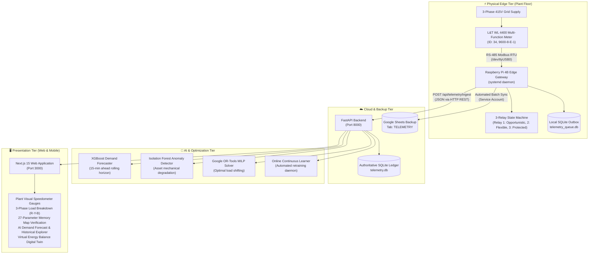

<div align="center">

# 🏭 Factory Energy Autopilot

**Autonomous Industrial Energy Optimization, Peak Demand Mitigation & Edge Telemetry Platform**

*“Optimize the energy around production — never optimize by stopping production.”*

[](https://fastapi.tiangolo.com)
[](https://nextjs.org)
[](https://python.org)
[](https://modbus.org)
[](https://raspberrypi.com)
[](https://developers.google.com/sheets/api)
[]()
[]()

</div>

---

## 📌 Executive Summary

**Factory Energy Autopilot** is an enterprise-grade cyber-physical system designed to optimize electrical power demand across heavy manufacturing plants. By pairing real-time Modbus RTU telemetry acquisition from Point of Common Coupling (PCC) incomers with machine learning (XGBoost, Isolation Forest) and constraint satisfaction solvers (Google OR-Tools), the platform eliminates peak contract demand penalties, improves power quality, and detects asset anomalies without compromising throughput or machine duty cycles.

The system features **dual operating modes** selectable with a single toggle:
1. **LIVE FACTORY (Hardware Mode)**: Acquires continuous physical 3-phase measurements (volts, current, power factor, grid frequency, active/apparent power, energy) from an industrial **L&T WL 4400 Multi-Function Meter** connected over RS-485 Modbus RTU to a **Raspberry Pi 4B** edge gateway, syncing to FastAPI, Google Sheets, and an offline-resilient local SQLite outbox.
2. **SIMULATION (Digital Twin Mode)**: Calibrated against real-world industrial demand traces (UCI Steel Industry Energy Consumption dataset), generating realistic manufacturing load curves and allowing operators to simulate surge events and peak-shaving dispatch actions safely.

---

## 🏛️ System Architecture



---

## ⚡ Hardware & Edge Telemetry (Raspberry Pi 4B)

The edge gateway operates as an autonomous, self-healing systemd service (`energy-autopilot-telemetry.service`) running on a Raspberry Pi 4B:

### 1. Modbus RTU Memory Map Acquisition
- **Meter Model**: Larsen & Toubro (L&T) WL 4400 Multi-Function Meter
- **Interface**: USB-to-RS485 Dongle (`/dev/ttyUSB0`)
- **Protocol Configuration**: Modbus RTU, 9600 baud, 8 data bits, **Even Parity**, 1 stop bit (Slave ID: 34).
- **Endianness Decoding**: Decodes all 27 Modbus holding registers (40101 to 40217) in **CDAB / Word-Swapped Little-Endian IEEE-754 Float** order:
  $$\text{float} = \text{unpack}(">f", \text{pack}(">HH", \text{low\_word}, \text{high\_word}))$$
- **Parameters Monitored**:
  - **Active Power**: Total Watts (40101), Phase $W_R$ (40103), Phase $W_Y$ (40105), Phase $W_B$ (40107).
  - **Power Factor**: Average PF (40117), Phase $PF_R$ (40119), Phase $PF_Y$ (40121), Phase $PF_B$ (40123).
  - **Apparent Power**: Total VA (40125), Phase $VA_R$ (40127), Phase $VA_Y$ (40129), Phase $VA_B$ (40131).
  - **Line Voltage**: $V_{LL}$ Avg (40133), $V_{RY}$ (40135), $V_{YB}$ (40137), $V_{BR}$ (40139).
  - **Phase Voltage**: $V_{LN}$ Avg (40141), $V_R$ (40143), $V_Y$ (40145), $V_B$ (40147).
  - **Current**: Total Current (40149), Phase $I_R$ (40151), Phase $I_Y$ (40153), Phase $I_B$ (40155).
  - **Frequency & Energy**: Grid Frequency Hz (40157), Wh (40159), VAh (40161), Load Hours (40217).

### 2. Automated 3-Relay Demand Mitigation State Machine
- **GPIO Pinout**:
  - `GPIO 25`: Relay 1 — Opportunistic / Non-critical loads (e.g., HVAC pre-coolers, batch heaters)
  - `GPIO 24`: Relay 2 — Flexible production loads (e.g., secondary pumps, storage compressors)
  - `GPIO 23`: Relay 3 — Protected loads (coils safe, alarm buzzer / visual beacon)
- **Safety Mode**: Defaults strictly to `MONITOR_ONLY` mode (simulated state changes with coils de-energized). Set `RELAY_MODE=ACTIVE` in `.env` only after plant engineer approval.
- **Dynamic Hysteresis**: Prevents relay hunting through anti-inrush stagger delays and 5.0 kW restore hysteresis.

### 3. Fault-Tolerant Outbox & Offline Store-and-Forward
- If Wi-Fi or backend connectivity drops, incoming meter packets are persisted locally in `telemetry_queue.db`.
- When connectivity resumes, a dedicated background recovery worker drains pending records chronologically and syncs both FastAPI and Google Sheets without data loss.

### 4. Hardware Abstraction Layer (HAL)
The codebase isolates hardware drivers in `hardware_adapters.py`:
- `RaspberryPi4BMeterAdapter` & `RaspberryPi4BRelayAdapter`: Production-ready RS-485 Modbus RTU & RPi.GPIO implementation.
- `ArduinoUnoQMeterAdapter` & `ArduinoUnoQRelayAdapter`: Pre-architected adapter stubs for seamless migration to Arduino UNO Q micro-PLC bridges.

---

## 🤖 AI Models & Industrial Analytics

| Model / Engine | Technique | Target Objective | Industrial Benchmark |
| :--- | :--- | :--- | :--- |
| **Demand Forecaster** | XGBoost Regressor | Predicts plant-wide kW 15 minutes ahead | Mean Absolute Error (MAE) < 4.2 kW on UCI Steel dataset |
| **Online Learner** | Incremental Retraining Daemon | Updates XGBoost weights on fresh telemetry every 50 packets | Continuous drift mitigation against seasonal load shifts |
| **Anomaly Detector** | Isolation Forest (Unsupervised) | Flags machine-level mechanical friction, bearing wear, idle waste | Sub-second anomaly classification per asset |
| **Peak Load Solver** | Google OR-Tools MILP | Re-schedules flexible equipment to keep peak demand below contract limit | **0% reduction** in 24-hour total production output |
| **Virtual Disaggregation** | Admittance Fingerprinting | Decomposes aggregate PCC incomer reading into individual machine power | Eliminates requirement for costly submeters on every single machine |

---

## 💻 Tech Stack

### Frontend
- **Framework**: [Next.js 15](https://nextjs.org/) (App Router, React Server Components)
- **Styling**: [Tailwind CSS v4](https://tailwindcss.com/)
- **Data Visualization**: [Apache ECharts](https://echarts.apache.org/) (`echarts-for-react`)
- **Real-Time Client**: Polling hooks, HTML5 Audio Alerts, responsive mobile drawer
- **QR Code Management**: Dynamic industrial equipment passport QR generation

### Backend
- **Framework**: [FastAPI](https://fastapi.tiangolo.com/) (Python 3.10+)
- **Optimization**: [Google OR-Tools](https://developers.google.com/optimization) (Mixed-Integer Linear Programming)
- **Machine Learning**: [XGBoost](https://xgboost.readthedocs.io/), [scikit-learn](https://scikit-learn.org/)
- **Persistence**: SQLite with WAL mode (`telemetry.db`), Google Sheets API (`gspread`)
- **Server Engine**: [Uvicorn](https://www.uvicorn.org/) with multi-worker support

### Edge / IoT
- **Hardware**: Raspberry Pi 4B (Broadcom BCM2711, 4GB RAM)
- **Serial Bus**: RS-485 Modbus RTU over USB UART
- **Modbus Driver**: `minimalmodbus` + `pyserial`
- **GPIO Driver**: `RPi.GPIO`
- **Daemon Manager**: Linux `systemd`

---

## 🚀 Getting Started

### 1. Prerequisites
- **Node.js**: v18.0.0 or higher
- **Python**: v3.10 or higher
- **Git**: Installed and configured

### 2. Repository Setup
```bash
git clone https://github.com/Rewat7143/Smart-factory-optimizer.git
cd Smart-factory-optimizer/factory-energy-autopilot
```

### 3. Environment Configuration
Copy the template `.env.example` files:
```bash
# Root / Backend environment
cp .env.example backend/.env

# Raspberry Pi edge environment
cp raspberry_pi/.env.example raspberry_pi/.env
```

Edit `backend/.env`:
```env
PORT=8000
HOST=0.0.0.0
DATABASE_URL=sqlite:///database/telemetry.db
GOOGLE_SHEET_NAME=smart factory opti
GOOGLE_SHEET_TAB=TELEMETRY
```

Edit `raspberry_pi/.env`:
```env
ENERGY_API_BASE_URL=http://<BACKEND_IP>:8000
SERIAL_PORT=/dev/ttyUSB0
METER_ID=34
BAUDRATE=9600
PARITY=EVEN
PEAK_DEMAND_THRESHOLD_KW=150.0
RELAY_MODE=MONITOR_ONLY
```

### 4. Running the Development Stack
Start both FastAPI backend and Next.js frontend concurrently using the provided launcher:
```bash
chmod +x start-dev.sh
./start-dev.sh
```

- **Frontend Application**: [http://localhost:3000](http://localhost:3000)
- **Backend API Docs (Swagger)**: [http://localhost:8000/docs](http://localhost:8000/docs)
- **Live Factory State Endpoint**: [http://localhost:8000/api/factory/state?mode=LIVE](http://localhost:8000/api/factory/state?mode=LIVE)

---

## 🍓 Raspberry Pi Edge Deployment

To deploy the edge telemetry daemon on the Raspberry Pi 4B:

1. **Connect Hardware**:
   - Plug the USB-RS485 adapter into the Raspberry Pi.
   - Wire terminal **A (+)** on the adapter to terminal **A (+)** on the L&T WL 4400 meter.
   - Wire terminal **B (-)** on the adapter to terminal **B (-)** on the L&T WL 4400 meter.
   - Verify meter RS-485 settings: Address = `34`, Baud = `9600`, Parity = `EVEN`.

2. **Automated Setup Script**:
   ```bash
   cd raspberry_pi
   chmod +x setup_pi.sh
   ./setup_pi.sh
   ```

3. **Enable & Start Systemd Service**:
   ```bash
   sudo cp energy-autopilot-telemetry.service /etc/systemd/system/
   sudo systemctl daemon-reload
   sudo systemctl enable energy-autopilot-telemetry.service
   sudo systemctl start energy-autopilot-telemetry.service
   ```

4. **Inspect Live Edge Logs**:
   ```bash
   journalctl -u energy-autopilot-telemetry -f
   ```

---

## 🧪 Testing & Verification

The backend includes a comprehensive automated test suite covering API contracts, simulation physics, telemetry normalizers, Modbus decoding, and optimization routines:

```bash
cd backend
source .venv/bin/activate
pytest tests/ -v
```

```text
tests/test_assets_api.py .........                     [ 23%]
tests/test_control_flow.py ...                         [ 30%]
tests/test_forecast_assertions.py .....                [ 43%]
tests/test_history_api.py ....                         [ 53%]
tests/test_live_pipeline.py ......                     [ 69%]
tests/test_relay_and_adapters.py ....                  [ 79%]
tests/test_rpi_pipeline.py ....                        [ 89%]
tests/test_telemetry.py ....                           [100%]

======================== 39 passed in 2.91s ========================
```

---

## 📑 Core API Endpoints

| Method | Endpoint | Description |
| :--- | :--- | :--- |
| `POST` | `/api/telemetry/ingest` | Ingests canonical telemetry packet from Raspberry Pi gateway |
| `GET` | `/api/factory/state` | Returns plant-wide demand, active assets, and live status (`mode=LIVE` or `SIMULATION`) |
| `GET` | `/api/telemetry/source-status` | Edge connection health, active data source, and packet age |
| `GET` | `/api/telemetry/latest` | Returns most recent 27-parameter Modbus reading with storage health |
| `GET` | `/api/telemetry/history` | Historical telemetry readings cache for streaming strip charts |
| `GET` | `/api/telemetry/layman_analytics` | Plain-English electrical health summary for field technicians |
| `POST` | `/api/optimize` | Runs Google OR-Tools MILP peak-shaving load dispatcher |
| `GET` | `/api/assets` | Asset registry with rated capacities, operating states, and PCC bindings |
| `POST` | `/api/control/dispatch-action` | Executes operator-approved load-shedding control actions |

---

## 🛡️ Security & Privacy Notice

- All Google Service Account JSON files, private keys, `.env` files, and local SQLite databases are strictly excluded from git tracking via `.gitignore`.
- Edge relays default to `MONITOR_ONLY` to prevent unintended physical equipment actuation during commissioning.
- CORS policies in development allow LAN access (`0.0.0.0`) for mobile scanning of equipment QR passports.

---

## 📜 License

Distributed under the MIT License. See `LICENSE` for more information.
